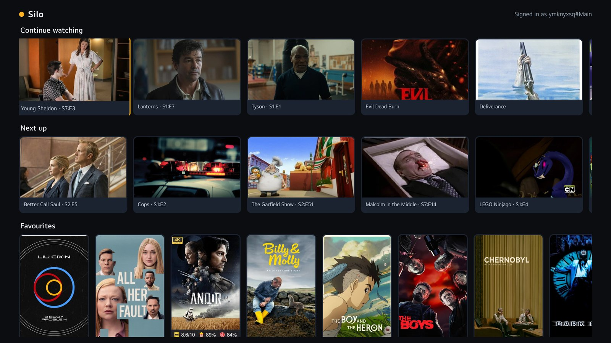
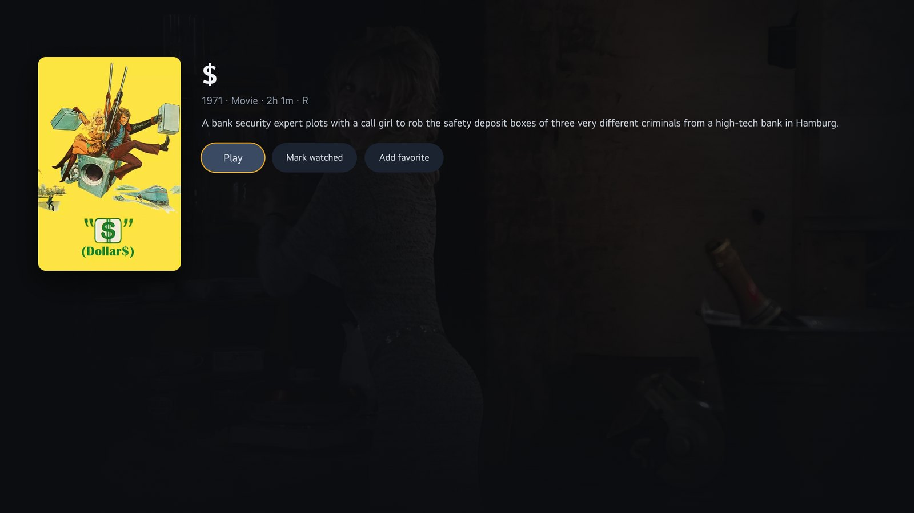
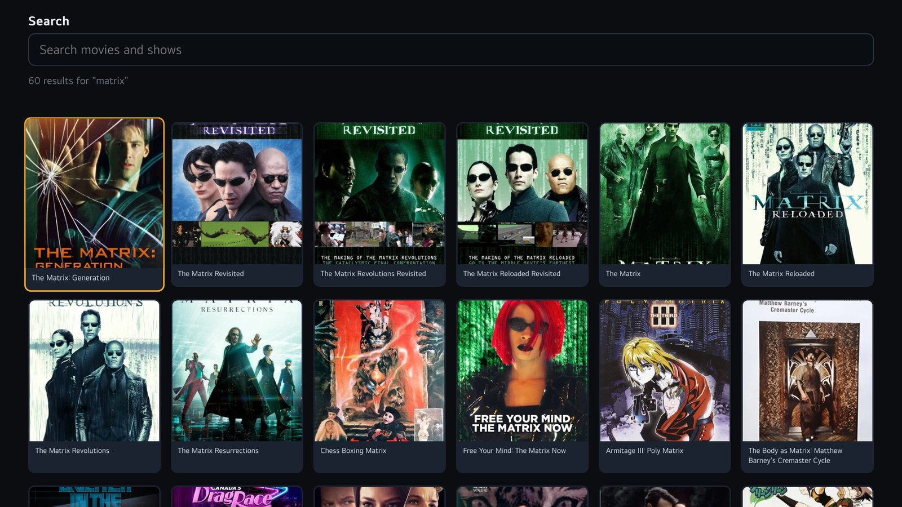
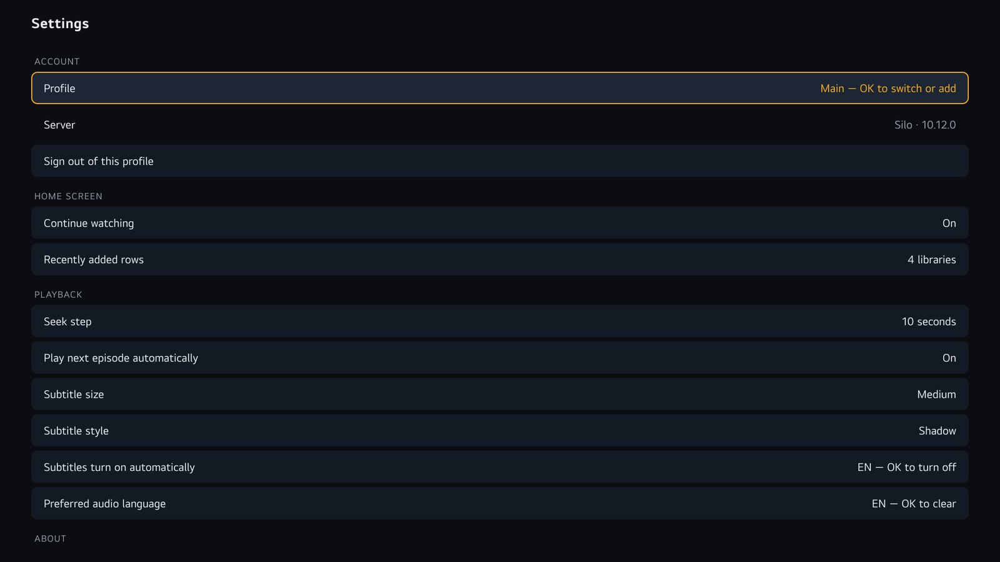

# Silo TV — unofficial LG webOS client

A client for [Silo](https://siloserver.org/), the self-hosted media server, for
LG televisions running webOS. It speaks Silo's **Jellyfin-compatible API**, so it
works with the Silo server you already run — this project is the TV front end
only, the equivalent of Silo's Apple TV and Android TV apps.



Not affiliated with, endorsed by, or supported by Silo Media L.L.C.

## What it does

- **Quick Connect sign-in** — a six-digit code approved from your phone — or a
  password using Silo's `username#Profile` form. Profiles are supported.
- **Continue watching**, **Next up**, recently added per library, favourites.
- **Library browsing** with sort, filter, genre and A–Z jump.
- **Seasons and episodes**, with automatic next-episode playback.
- **Subtitles** read straight from the file for embedded tracks (Silo can take
  minutes to extract them, so the TV parses the MKV itself), plus size and style
  options and a track picker.
- **Audio track picker**, multi-version titles defaulting to the best source,
  and the chosen track reported back to the server.
- **Resume and progress** shared with Silo's own apps and any other client.

| | |
|---|---|
|  |  |
|  |  |

## Requirements

- An LG webOS TV, rooted, with
  [Homebrew Channel](https://github.com/webosbrew/webos-homebrew-channel)
  installed — this app is unsigned.
- Your own Silo server, with third-party client access enabled, and its
  **Jellyfin-compatible address** (Silo's docs call this
  [Jellyfin-compatible apps](https://siloserver.org/docs/jellyfin-apps); the
  address is often different from the web UI's).


## Add this repository to Homebrew Channel

The app is not listed in the central repository. You can add this project as a
repository instead:

```
https://raw.githubusercontent.com/clacksy/silo-webos/main/repo/apps.json
```

In Homebrew Channel: **Settings → Add repository**, paste that URL, then open the
app list and install *Silo TV*. Updates arrive the same way as any other package,
because the repository points at `releases/latest`.

## Install

Download the `.ipk` from
[Releases](https://github.com/clacksy/silo-webos/releases/latest) and sideload it
over SSH on the TV:

```sh
scp silo-webos-*.ipk root@<tv-ip>:/tmp/
ssh root@<tv-ip> "luna-send -i luna://com.webos.appInstallService/dev/install \
  '{\"id\":\"io.github.clacksy.silotv\",\"ipkUrl\":\"/tmp/silo-webos-0.10.2.ipk\",\"subscribe\":true}'"
```

Each release ships a manifest next to the IPK with its size and SHA-256, so you
can check the download before installing.

A one-click entry inside Homebrew Channel needs this project listed in the
central [apps-repo](https://github.com/webosbrew/apps-repo); that is not done yet.

## Build

```sh
python3 build.py            # development package, whatever js/seed.js holds
python3 build.py --release  # refuses to package a session token, prints the sha256
```

`js/seed.js` is gitignored: it can hold a session token and a default server so a
development TV skips sign-in. A release build must not contain either, which is
what `--release` enforces.

## Test

`tools/smoke_test.py` drives the app running on the TV through the DevTools
protocol and checks 30 behaviours — navigation, the settings screen, search,
sort and genre filtering, and that nothing errors.

```sh
ssh -f -N -L 9998:127.0.0.1:9998 <tv>   # the inspector port is loopback-only
python3 tools/smoke_test.py
```

There is no automated test for playback or subtitle rendering: those need eyes
on a real screen.


## Debugging on the TV

The web inspector listens on port 9998 but only on the TV's loopback interface,
and only while a web app is running. `tools/inspect.sh` handles both:

```sh
tools/inspect.sh          # launches the app if needed, tunnels, prints the target URL
# in Chrome: chrome://inspect -> Configure... -> localhost:9998
```

`tools/tour.sh` screenshots five screens and reports console errors and failed
requests — useful after a deploy:

```sh
tools/tour.sh             # writes ./tour-out/<timestamp>/
```

## Layout

```
appinfo.json     webOS manifest
index.html       screens: connect, home, library grid, detail, search, settings, player
css/app.css      styling and focus rings
js/api.js        Jellyfin-compatible client (auth, media, sessions)
js/app.js        screen routing, remote-key navigation, playback, subtitles
js/mkvsubs.js    reads embedded subtitles from the MKV itself over range requests
build.py         builds the IPK (ar + tar, no toolchain)
tools/           deploy and smoke-test helpers
packaging/       Homebrew Channel listing metadata
```

## Licence

MIT — see [LICENSE](LICENSE).

Developed with substantial AI assistance; the human author is responsible for the
code in it. Please read it before trusting it with your server.
